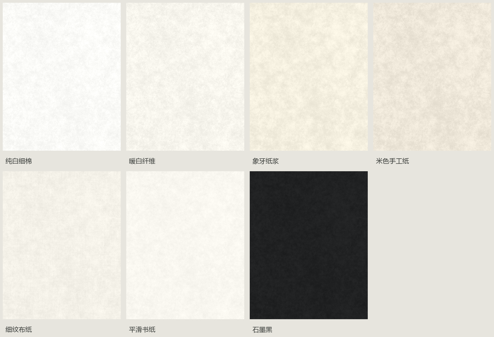
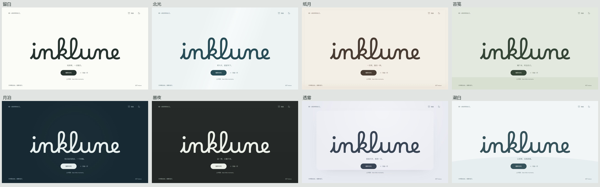

# Inklune

一款具有纸墨质感的书写工具，支持日夜书写、本地保存和纸页导出。React、TypeScript 与 Vite，适配桌面与手机。纸页和机械体验参考 Jerry Munyoka Nkongolo / Rafikki Studio 的原作独立重建。

**在线体验：[Inklune](https://lake-evendim.github.io/inklune/)** · **源码：[Lake-Evendim/inklune](https://github.com/Lake-Evendim/inklune)**

## GitHub Pages 发布

正式网址：https://lake-evendim.github.io/inklune/

源码保存在 `main`，静态构建发布到 `gh-pages`。仓库的 Settings → Pages → Build and deployment 使用 **Deploy from a branch**，分支为 **gh-pages**、目录为 **/ (root)**；GitHub 会在该分支更新后自动发布。

更新站点：使用 Node.js 22，在项目目录运行 `npm ci`，提交并推送源码到 `main`，再运行 `npm run deploy`。该命令会依次执行测试、构建，将 `dist/` 推送到 `gh-pages`；需要有仓库的 Git 推送权限。`.nojekyll` 随站点一起发布，静态资源由 Pages 直接提供。

网站使用相对资源路径和 `#write` 书写入口，可在 `/inklune/` 子路径下直接打开或刷新。稿件保存在访问者自己的浏览器中；线上站点与本地预览的存储彼此独立。将本地稿件转到线上时，请先在本地备份信盒，再在在线站点导入。

## 启动

Windows 双击 `start.cmd` 打开正式开始页。固定地址为 http://127.0.0.1:5174/。启动器使用后台静态构建，复用已经运行的服务。电脑重启后再次运行即可。旧 `compare.cmd` 和比较链接兼容打开正式应用。

建议使用 Node.js 22.18+。开发：`npm ci`、`npm run dev`；构建：`npm run build`；单元检查：`npm test`（需要支持 TypeScript 类型擦除的 Node.js 22）；发布：`npm run deploy`。开发地址通常为 http://127.0.0.1:5173/。`dist/` 可部署为静态站点，使用相对资源路径，通过 HTTP 打开。

输入回归：开发服务中打开 `/tests/interaction.html` 检查敲击、换行、中文输入法与删除；`/tests/input-performance.html` 使用独立临时纸页测试日夜模式下的快速输入、连续删除与长页渲染，不读写本地信盒。请保持测试页可见；后台帧率限制会影响动画测量。

普通按键保留完整敲击，快速连续输入及时显字并合并旧机械动作；连续删除保留已安排的动画帧。字形按组复用，显隐变化只更新受影响的墨迹块，运动参数仅由纸张和机械部件继承。

根因、修改与实测数据：[快速输入性能修复](docs/INPUT-PERFORMANCE-2026-10-25.md)。

## 当前开始页：01 留白

正式体验固定为「纯白细棉」日间背景与「黑绒静夜」夜间背景。日间使用 2048×2048 无损棉纸纹理；夜间使用 2560×1600 横版、1600×2400 竖版无损黑绒材质与固定尺度细颗粒。开始页与书写室共用同一材质和昼夜设置。

大 logo 略微上移，保持精修 Borel 笔写路径与原时序；动画和完成状态共用对齐屏幕像素的表面。最终品牌通过覆盖面积平均缩小，再按屏幕像素显示，改善弯转直边缘并避免重复插值；主题、窗口、DPR 和预览缩放变化时同步更新。

进入书写固定采用「从入口展开」（660ms），返回时收拢回入口（480ms）。主页标志提前准备，返回时复用渲染数据并重播原有书写动画。页面的「方案」入口、比较界面及旧的材质／过渡偏好读取已移除。旧比较链接直接打开正式工作区，旧浏览器选择不会覆盖最终设计；稿件与书写设置继续保存在原来的存储键中。

开始页背后提前准备一个完整编辑室，按准确稿件和配置发布就绪，进入完成后再聚焦。已有 103 项模拟 DOM 检查、18 项既有测试和构建通过；2026-10-23 品牌边缘精修已完成 16 项实际浏览器检查，覆盖局部曲线、桌面、手机、日夜、DPR、缩放预览和自然动画衔接。详情见 [弯曲边缘定位与修复](docs/LOGO-CURVE-REFINEMENT-2026-10-23.md)、[像素对齐修复](docs/LOGO-EDGE-FIX-2026-10-23.md)和[材质与动效调研](docs/START-MATERIAL-MOTION.md)。

## 历史开始页布局设计 · 2026-10-22

八套方案：留白、北光、纸月、苔笺、月泊、墨夜、透雾、潮白。每套都以几何中心的大幅 lowercase **inklune** 为主视觉，使用 Borel v10 的真实字形和上下文连笔关系。沿笔势的墨迹遮罩依序写出，约 2.31 秒完成，i 的点先在 220ms 内沿短斜向笔势点写完成，230ms 后开始正文笔势；开始书写始终可以立即操作。系统减少动态效果时直接显示完整字形。转向和交叉采用 18 段笔势与 12 个笔带区域独立显露，起笔遮罩使用超过路径长度的间隔，避免后面的连笔提前漏墨。

桌面、手机与日夜共 32 张历史设计截图作为调研存档保留。比较组件和实验路由已退出正式应用；历史比较验证脚本不再作为当前应用的验收工具。

品牌同步更新于开始页、书写页、信盒、关于、纸尾、PNG 签名、网页标题、备份文件名和启动器。沿用原存储键和旧启动器兼容入口，保留既有数据。

调研来源与各方案说明：[设计调研](docs/START-DESIGN-RESEARCH.md)。检查结果：[验证记录](VERIFICATION.md)。Borel OFL 许可证随项目分发。

## 已实现

- 重新设计书写界面：右上角常驻字数，中央纵向纸页，桌面侧边工具栏与手机薄底栏；桌面抽屉、手机底部面板，以及纸张／套件／书写／灯光四个设置分类。

- 可编辑纸页，支持中文输入、粘贴和每页 3,000 字符限制。
- 七种纸张：棉纤、旧时、云蓝、蔷薇、横线、亚麻与月夜羊皮纸；平面、弯曲两种形态。2048×2048 无损纹理在基准纸宽下按 512px 显示。
- 横线纸按正文首行基线和实际行框间距对齐，随字号、字体加载与窗口变化更新；空行、自动换行和进纸保持对齐，PNG 导出使用相同的基线间隙比例。
- 固定字距正文、稳定的逐字墨迹、色带缺口、墨色深浅与字号；删除时可擦除，或按原始字符位置留下划除痕迹。
- 绿色落字圆点按真实字体基线与句点的字形中心定位；缩短静止字锤和敲击行程，接触时显字、回收后推进；普通输入橙灯、回车绿色归位，空格与删除分别处理。
- 统一纸页滚动：滚轮、触控和原生滚动条共享一个进纸位置，书写室与工具固定；短文无需滚动，长文输入、粘贴与屏幕外光标导航自动跟随。阅读中开关设置或重新聚焦保持位置，点击胶囊回到编辑行。支持自动折行、中文拼写和确认敲击，候选文字不保存。
- Three.js 三维胶囊、圆柱导轨与伸缩字锤，共用机械坐标；真实弧面、金属反射、釉面与接触阴影。经典搪瓷、海玻璃、火山岩、青花瓷、胡桃木及南瓜灯、木乃伊、弗兰肯斯坦、水晶风暴共九套；经典搪瓷另有五种颜色。
- 夜间胶囊关闭环境镜面反射与清漆高光，取消横向亮带；保留低照度曲面、纸面照明和独立指示灯。日间维持套件原有材质，CSS 回退也取消夜间亮带。
- 精钢、黄铜与黑钢导轨，五种可独立组合的端饰；小花园或蛛网、蜘蛛装饰。南瓜烛光、绷带尾端摆动、触键电火花与晶体闪电均尊重减少动画偏好。
- Web Audio 合成机械打字声、回车、空格、删除与换纸声音。
- 长按胶囊 550ms 开启夜间模式：胶囊顶部向上投出有限灯口、弧形边缘与渐软远端的暖光，纸张暗部、导轨和胶囊保持低照度，灯源与字锤同步移动。
- 纸面照明只来自灯口实际投射的光束，范围外保持纸材原有的夜间暗度；不添加横跨书写行的椭圆补光或套件底部的独立反光池。光束的柔和边缘、亮度、范围与色温调节继续保留。
- 灯光分类集中调节强度（20–200%）、扩散角度（50–160°）、照射范围（40–200%）和冷暖；主页面右上角提供昼夜切换按钮。键盘聚焦胶囊后按 Enter 或空格也可切换昼夜。
- 初始灯光配置为强度 170%、扩散角度 130°、色温 2500 K、照射范围 120%。
- 浏览器本地自动保存，按月分组的信盒、全文搜索、花朵书签。
- 最近删除、恢复、删除后的撤销。
- TXT、PNG、打印／PDF 与 JSON 全信盒备份；导入备份时合并纸页并跳过相同 ID。
- 专注模式保留右上角字数；隐藏工具退出键盘焦点顺序。设置分类支持方向键及 Home／End，弹层管理焦点和背景滚动，适配减少动画偏好。

## 快捷键

| 操作 | 快捷键 |
| --- | --- |
| 新建纸页 | Ctrl / ⌘ + N |
| 导出文字 | Ctrl / ⌘ + S |
| 关闭弹层／切换专注模式 | Esc |

## 数据与原版差异

笔记和设置存入当前浏览器的 `localStorage`，键名为 `platen-paper-ink:v1`。请使用“备份信盒”保存完整 JSON；清除浏览器数据会清除本地笔记。恢复备份会合并笔记，不覆盖同 ID 的现有内容。

现用纸纹是独立生成的高分辨率素材，包含纸浆颗粒、纤维、压痕高光及各纸种的差异，不再使用前一版从截图拼接的低分辨率纸纹。机械部件为独立创建的 Three.js 几何体和材质；青花、木纹、织带与皮革纹理也由程序绘制。参考官方公开画面、版本 1.3.4 更新说明与用户反馈，但没有原作 iOS 源码或模型；套件是网页中的独立重建，不声称与原版资产完全相同。花园为矢量插画。未接入 iCloud 或付费购买。中文与英文字体可独立选择，默认中文 Noto Sans SC、英文 Courier Prime；宋体使用 Noto Serif SC Medium 的真实中文字形，保留所选英文字体的正常字重。墨迹以实色颗粒表现缺墨，保护细笔画与轮廓，纸页画布按屏幕物理像素对齐。

三维机械在开始页背后提前准备，套件比较预览按需加载；WebGL 初始化失败或上下文丢失时保留 CSS 机械与完整输入功能。灯光与纸材使用同一纸宽缩放。PNG 导出复用新的高分辨率纸材，导出的是纸页文字，不包含机械和装饰。

## 文件

- `src/App.tsx`：工作区、自动保存、菜单与快捷键。
- `src/Editor.tsx`：纸页输入、墨迹、导轨、胶囊和灯光。
- `src/useTypewriterMotion.ts`：固定坐标测量、动作队列、接触显字、归位与进纸。
- `src/typing.ts`：字符簇分割、选区差异与持久化墨迹种子。
- `src/typing.css`：正文固定字距、落字圆点、线性字锤与指示灯状态。
- `src/motion.css`：移动纸页、胶囊运动与打印还原。
- `src/usePaperLighting.ts`：缓存的 Canvas 光照场、曲线边缘、距离衰减与移动灯源。
- `src/lighting.css`：夜间机械材质、灯口、指示灯和纸面调光控件。
- `src/materials.css`：纸材、背景颜色、纹理比例和机械尺寸。
- `src/assets/paper-*.webp`：2048×2048 无损纸纹。
- `src/skins.ts`：纸材、套件与默认组合目录。
- `src/mechanismModel.ts`、`src/MechanismCanvas.tsx`：三维几何、材质和与机械动作同步的绘制。
- `src/KitGallery.tsx`：使用同一模型绘制的套件预览。
- `src/PaperDecorations.tsx`：花园及蛛网、蜘蛛。
- `src/Library.tsx`：信盒、搜索与最近删除。
- `src/SettingsPanel.tsx`：纸张、套件、书写与灯光分类。
- `src/ui.css`：新版书写界面、抽屉、手机面板与专注模式。
- `src/export.ts`：高分辨率纸页 PNG。
- `src/sound.ts`：机械音效。
- `src/styles.css`：拟物视觉、响应式和打印样式。

参考：[App Store 原版](https://apps.apple.com/cn/app/platen-paper-ink/id6809529696)。
