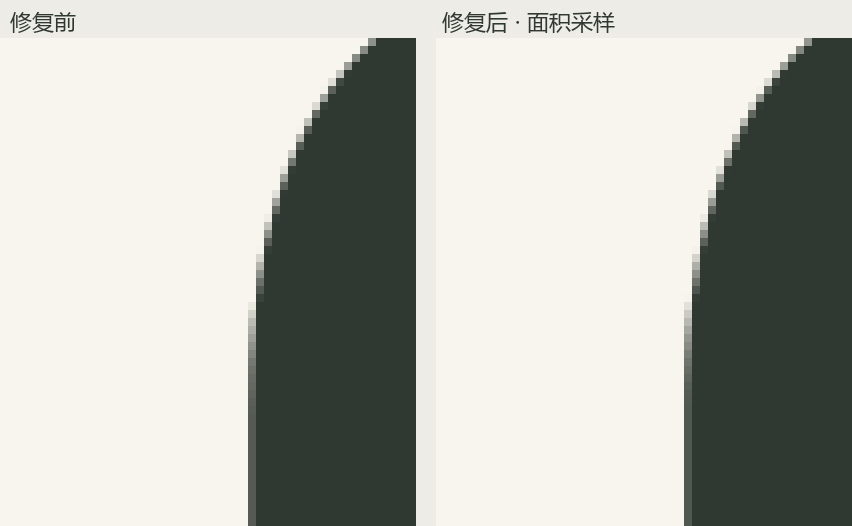

# Inklune 弯转直边缘精修

2026-10-23。当前正式构建 `index-B9kCGE_8.js`，CSS `index-yDucccMr.css`。

## 定位

用户提供的局部图呈现了上部弧线进入竖直外轮廓时的细小台阶和深浅不均。与原始 Borel 轮廓及已绘制画布对照后，本轮采用 l 上部外侧同类弧线作为定量验证区域，物理画布区域为 `(428,28,52,61)`，目标画布为 1025×280。

原始轮廓在该处的竖直侧与二次贝塞尔连接点、控制点具有相同 x 坐标 465.88，切线方向连续；没有额外折线或几何突出。剩余误差来自 `drawImage` 缩小滤波：其过滤结果与每个最终像素的实际覆盖面积仍有差异，尤其在曲线逐渐趋于竖直时形成不均匀的透明度带。

上一轮验证证明屏幕能保留最终画布的像素，但没有证明画布内部的覆盖值足够准确。本轮补上了这一层检查。

## 修复

新增 `src/wordmarkCoverage.ts`。对高采样原始轮廓中，落入每个最终屏幕像素的源像素透明度逐一平均，生成覆盖值；保留同一墨色，避免缩小滤波对弧线边缘再次加权。`CrispWordmark.tsx` 使用该结果绘制最终画布。

此方式统一用于整个 logo。Borel、原始字形、逐笔书写路径和时序保留，现有像素对齐、DPR／主题／预览缩放响应、工作画布上限及释放机制保持。计算发生在完成画布准备或配置变化时，不在每个动画帧重复执行。

## 实际验证

在独立 Chrome 147 中，以原始轮廓的 32 倍面积采样作为局部参考：

| 指标 | 修复前 | 修复后 |
| --- | ---: | ---: |
| 边缘平均 alpha 覆盖误差（0–255） | 7.365 | 1.527 |
| 最大 alpha 覆盖误差（0–255） | 18 | 6 |
| 与参考的最大边缘曲率覆盖差异（像素） | 0.0706 | 0.0196 |

本轮实际正式代码的局部结果与 4 倍面积平均对照一致。上述值用于评价这段边缘的采样误差，不是整体审美评分。

TypeScript / Vite 构建与 18 项既有测试通过。`tools/verify-logo-rendering.py` 增加弯转直边缘与 32 倍参考的回归检查，16 项实际浏览器检查全部通过；覆盖桌面 DPR1/1.25/1.5/2、仅 DPR／高度改变、390×844/DPR3 手机日夜、减少动态效果、缩放预览和最终屏幕覆盖保留。自然播放记录 210 个 RAF 几何帧，SVG → canvas 的位置／尺寸跳变量为 0，无页面脚本异常。

- [用户提供的局部图](inklune-verification/curve-refinement-20261023/user-curve.png)
- [采样定位对照原始数据](inklune-verification/curve-refinement-20261023/curve-coverage-before.json)
- [修复后的局部参考对照](inklune-verification/curve-refinement-20261023/curve-coverage-probe.json)
- [当前正式页面局部截图](inklune-verification/curve-refinement-20261023/curve-fixed-screen.png)
- [16 项实际浏览器验证与自然播放几何帧](inklune-verification/curve-refinement-20261023/logo-fix-checks.json)
- [桌面页面](inklune-verification/curve-refinement-20261023/logo-fixed-desktop-125.png)
- [手机白天](inklune-verification/curve-refinement-20261023/logo-fixed-phone-day.png)
- [手机夜晚](inklune-verification/curve-refinement-20261023/logo-fixed-phone-night.png)
