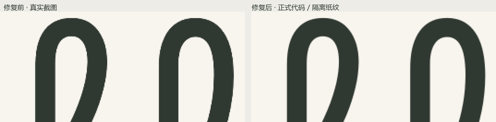

# Inklune 品牌边缘修复

2026-10-23。正式构建 `index-C4LIFhv4.js` / `index-yDucccMr.css`，已在 5174 服务生效。

后续弯转直边缘精修已发布为 `index-B9kCGE_8.js`，将浏览器缩小滤波改为明确的覆盖面积平均，当前 16 项实际浏览器检查通过。见 [弯曲边缘定位、修复与对照](LOGO-CURVE-REFINEMENT-2026-10-23.md)。下文为前一轮像素对齐修复的记录。

## 实现

`CrispWordmark.tsx` 按最终显示矩形、屏幕 DPR 和同源预览 iframe 的缩放测量物理像素。SVG 书写与最终 canvas 使用同一个表面、同一个尺寸和位移；位置以 CSS transform 对齐，避免布局偏移在绘制时被提前舍入。

原始 Borel 贝塞尔轮廓先以最终屏幕的 4 倍采样绘制，再用高质量缩小生成与屏幕匹配的 canvas。最大工作画布限制为 1600 万像素，高 DPR 时适当减少采样倍数；临时画布在绘制后释放。位置变化只更新位移，不重新分配画布。

完成的 canvas 已经包含精确的透明度边缘覆盖，因此只对该层使用 `image-rendering:pixelated` 保留这些预计算像素。它不用于 SVG 动画、纸纹或其他界面，也不代替抗锯齿。实际对照表明，单独采用此样式而不对齐位移会变差；必须与位置映射、高质量缩小一起使用。

监听窗口、DPR、VisualViewport 变化和同源预览 iframe 的尺寸／缩放变化。即使 CSS 尺寸没变，屏幕像素比变化也会更新。减少动态效果时从首个渲染帧显示完成的品牌。

Borel、小写 `inklune`、原始字形、18 段书写笔势、12 个区域、i 点 220ms／正文 230ms／整词 2310ms 均保留。稿件和书写室功能未修改。

## 实际验证

- TypeScript / Vite 正式构建通过，现有 18 项单元测试通过。
- 使用独立 Chrome 147.0.7727.56 配置，在实际浏览器绘制当前正式构建，15 项检查全部通过；无页面脚本异常。
- 桌面 DPR 1、1.25、1.5、2，固定 CSS 视口下只改变 DPR、只改变视口高度，画布尺寸和位置均随之更新。
- 390 × 844 CSS 的手机视口、DPR 3，白天／夜晚均通过。
- 自然播放采集 210 个 RAF 帧的位置与尺寸，SVG → canvas 切换的跳变量为 0。这是自然播放几何检查，不是全词中间帧笔画覆盖的重新验收。
- 减少动态效果时第一个渲染帧即为完成状态。
- 实际比较页 iframe 约 0.56375 倍缩放通过；仅改变父级 iframe 缩放也会重新匹配屏幕。
- 关闭纸纹作隔离对照后，屏幕截图与原 canvas 透明度合成的单通道最大差异不足 1 个 RGB 灰阶；边缘平均差异约 0.287。证明最终显示保留了预先计算的边缘覆盖，未再次产生明显插值。该数值不是审美评分。
- 已通过 OpenCLI 在桌面实际标签确认新构建、位移、1025 × 280 屏幕画布和显示样式。以下本轮最终截图由独立 Chrome 的实际页面绘制取得。

左侧为前次定位时的真实截图，右侧为本轮正式代码在平色背景上的实际截图。保留原像素再放大，避免展示缩放掩盖阶梯。正式页面纸纹未删除。

- [桌面正式页面](inklune-verification/logo-fix-20261023/logo-fixed-desktop-125.png)
- [手机白天](inklune-verification/logo-fix-20261023/logo-fixed-phone-day.png)
- [手机夜晚](inklune-verification/logo-fix-20261023/logo-fixed-phone-night.png)
- [15 项检查与 210 帧几何记录](inklune-verification/logo-fix-20261023/logo-fix-checks.json)

可复查工具：`tools/verify-logo-rendering.py`。使用本机独立 Chrome 配置检查 localhost 正式服务，不连接用户浏览器配置或稿件。
