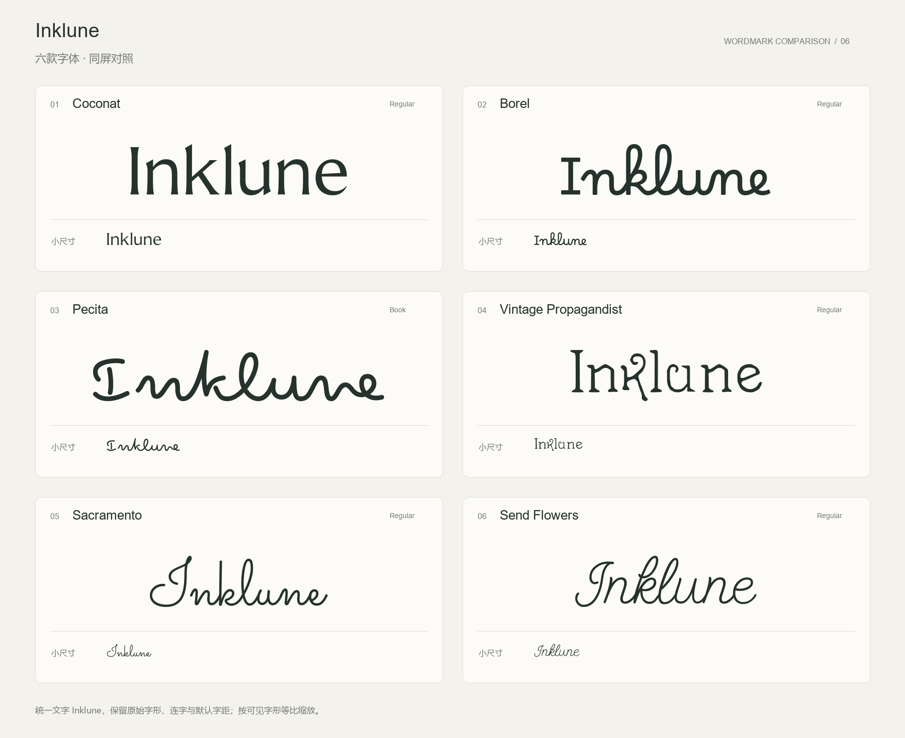

# Inklune 字体方案参照

2026-10-23：用户提供六款字体同屏对照图，并要求记住这组字体方案。后续字体方案讨论以这张原图及以下编号、名称和字重为参照。

| 编号 | 字体 | 字重 |
| --- | --- | --- |
| 01 | Coconat | Regular |
| 02 | Borel | Regular |
| 03 | Pecita | Book |
| 04 | Vintage Propagandist | Regular |
| 05 | Sacramento | Regular |
| 06 | Send Flowers | Regular |

原图同时展示大尺寸品牌字样与小尺寸效果，使用首字母大写的 `Inklune` 作比较。图中说明保留原始字形、连字与默认字距，并按可见字形等比缩放；这是对参照图的记录。

本次用户要求保存方案参照，没有重新选择字体或要求切换实际品牌的大小写。沿用此前已确定的 Borel 和小写 `inklune`，后续修改按用户明确选择执行。

